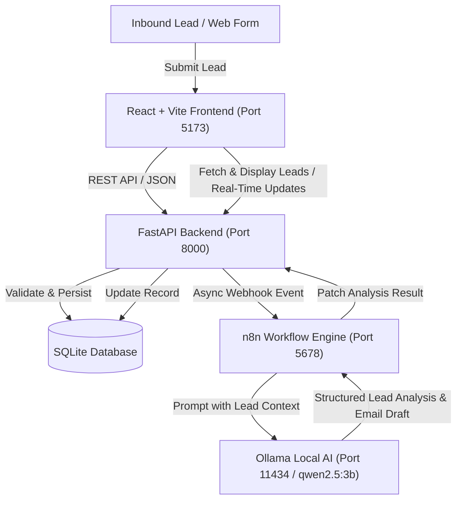

# LeadFlow AI - System Architecture

## Overview
**LeadFlow AI** is an intelligent, event-driven lead management and business automation platform tailored for high-velocity Go-To-Market (GTM) operations. It bridges inbound lead intake, automated qualification via local AI models, and flexible workflow orchestration.

## Architecture Diagram & Flow

## Core Components

| Component | Technology | Responsibility |
|---|---|---|
| **Frontend** | React 18 + Vite | Interactive GTM dashboard with metrics, lead intake, status tracking, email draft previews, and automation monitoring. |
| **Backend** | Python 3.14 + FastAPI + SQLAlchemy | Business logic, data validation (Pydantic), CRUD operations, database transactions, and webhook dispatching. |
| **Database** | SQLite | Lightweight local ACID-compliant relational data store with zero external cloud dependencies. |
| **Workflow Engine**| n8n | Orchestrates post-intake automation, conditional branching, webhook relays, and AI pipeline orchestration. |
| **Local AI** | Ollama (`qwen2.5:3b`) | Zero-cost, privacy-first local LLM inference for lead qualification (HIGH / MEDIUM / LOW), justification, and personalized outreach drafting. |

## Key Architectural Principles for GTM Engineering
1. **Separation of Concerns:** Python FastAPI owns data integrity and core domain logic; n8n handles workflow orchestration and integrations.
2. **Zero Paid APIs:** Completely local and self-contained execution using SQLite and Ollama.
3. **Resilience & Fallbacks:** If the AI service (Ollama) or n8n is offline, the backend falls back gracefully to rule-based qualification so lead intake is never blocked.
