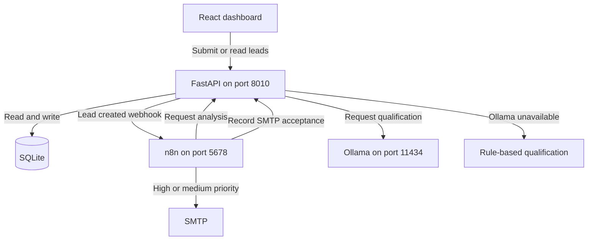

# LeadFlow AI architecture

LeadFlow AI captures inbound sales leads, qualifies them, and drafts outreach. The core app runs locally. n8n and email sending are optional.

1. FastAPI validates and saves the lead before dispatching the webhook. Intake still works if n8n is offline. In that case, trigger analysis manually through `POST /api/leads/{lead_id}/analyze`.
2. Analysis uses Ollama with `qwen2.5:3b` by default. If the model is unavailable or the request fails, the API uses rule-based scoring and stores the result in SQLite.
3. With SMTP configured, the imported workflow sends an acknowledgement for high- and medium-priority leads. The email callback records SMTP acceptance for the lead's address. The generated outreach draft is available in the analysis response.

See the [quick start](../README.md) and the [n8n setup](../n8n/README.md).
